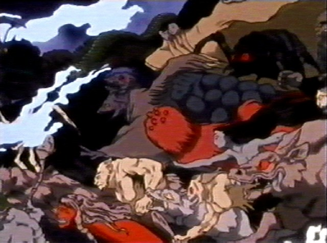
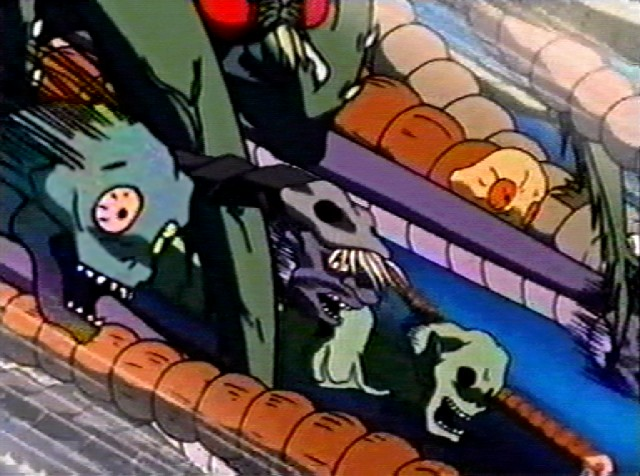
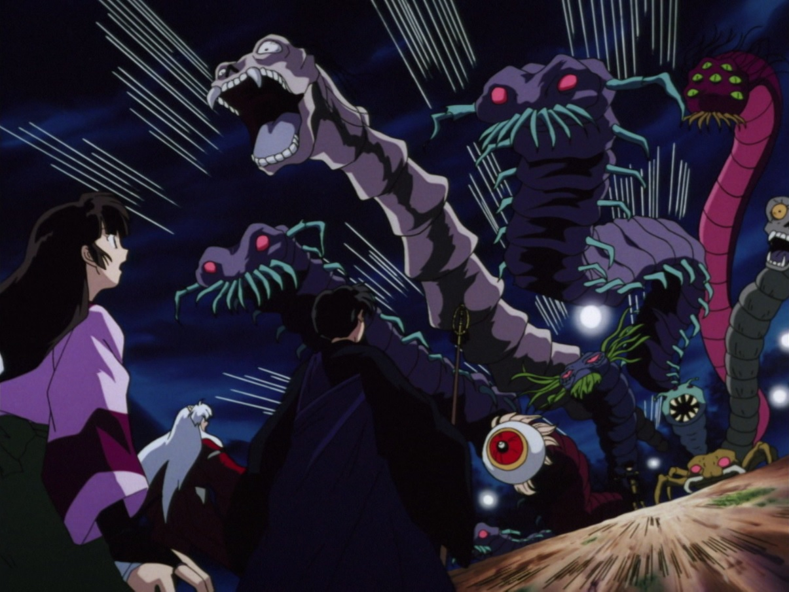
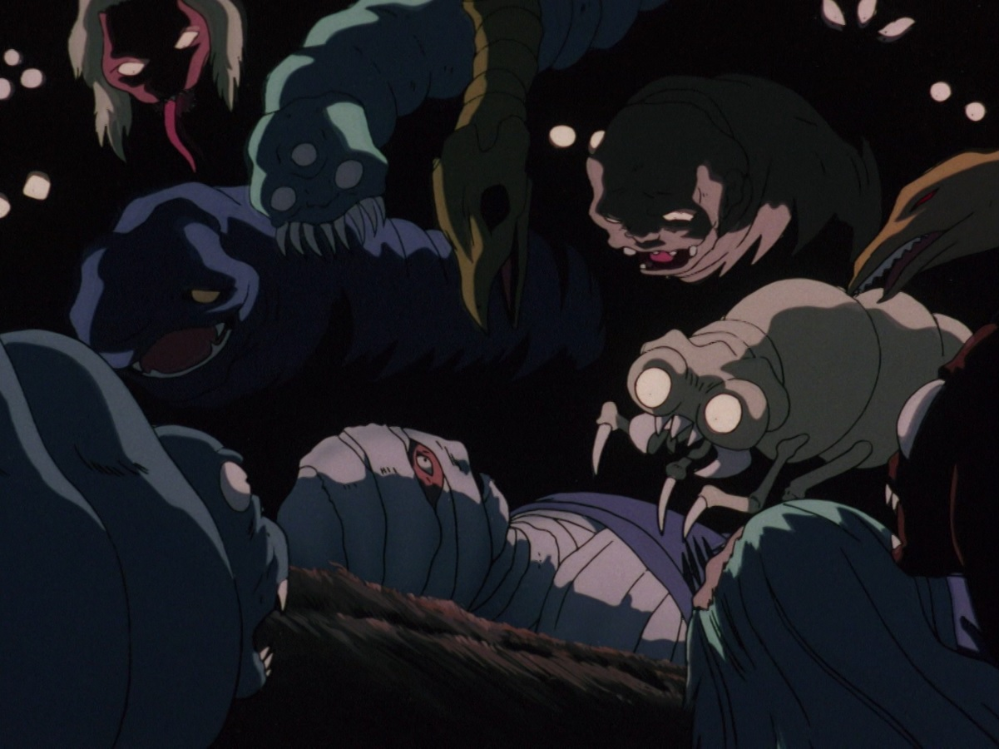

# 无名群妖动画参考 · 十种外形

日期：2026-10-26。用户已确认十种参考用于基础小怪制作，01～10资源与首版行为已完成，见[基础小怪资源说明](unnamed-monster-assets.md)。本文仅记录原始动画画面可见信息，未知的原作结构继续保留未知。

直接打开 [图像审核页](references/unnamed-yokai/review.html)，顶部先展示四个新增局部，再展示已采用六种；四张完整原图均可对照。已制作十种的游戏动作图可在[资源预览](../assets/monsters/preview.html)查看。

## 范围与命名

- 已有尸舞鸦、蜘蛛头、最猛胜、极乐鸟、妖鼠群继续沿用。本批补充来自动画群妖场景的无名个体参考。
- 下列名称全部是按画面特征起的**审核用暂称**，不是官方名称；十种外形不等同于原作已确立的十个独立物种。新增个体以群妖背景外形收录，尚未核实专名。
- 图A、B来自 IMDb 对应分集页；新增图C、D来自非官方截图档案 Gary’s “Inuyasha” Page 2。集数和事件与读卖电视台官方剧情页交叉核对。第21话在官方旧站与第22话合并列为特别篇；未核对完整视频及准确时间码。
- 局部展示仅通过网页裁切原图视窗实现，没有重绘、补画或生成参考。遮挡、画外结构和未知能力保留未知。

## 第二批四种 · 已采用

| 编号 | 暂称 | 动画来源与原图位置 | 画面可确认的结构 | 仍缺少的参考 | 状态 |
| --- | --- | --- | --- | --- | --- |
| 07 | 翼膜人面妖 | 第24话，图C最上部中央至右侧 | 深色长发、人面、浅褐上身、背后大片翼膜状轮廓及前方细长肢体 | 翼端、下半身、结构完整连接；性别、物种和飞行能力均未确认 | 已采用为基础小怪 |
| 08 | 瘤背长颈妖 | 第24话，图C上部中央，红色个体后方 | 向左伸出的紫灰头颈、深蓝灰圆块凸起的背部、褐色刺毛状边缘 | 完整躯干、四肢、尾部；凸起是否硬甲或特殊器官未知 | 已采用为基础小怪 |
| 09 | 青面独眼妖 | 第28话，图D左侧中央屋檐之间 | 青蓝面部、画面可见一只带深色斑点的浅色圆眼、黑色毛刺与尖牙口 | 另一侧眼部、完整身体、动作；“独眼”仅按本帧暂称 | 已采用为基础小怪 |
| 10 | 骷面垂须妖 | 第28话，图D中央偏下横梁下方 | 灰紫骷面轮廓、两处暗色眼窝状区域、齿口和浅色下垂须状结构 | 完整身体、动作；须状结构的性质与真实骨骼均未确认 | 已采用为基础小怪 |

与既有参考的区别：07以翼膜和人面轮廓为主；08以瘤状背部和长颈为主；09保留完整脸面与齿口，区别于04裸露大眼球；10以骷面和垂须为主，区别于06浅发长舌鬼面。上述仅为可见外形比较，不赋予能力、数值或首领身份。

用户审核通过后，07～10已按基础小怪规格制作PNG、八姿势动作图及怪物配置。现有无名基础小怪十种，连同原有五种，运行库为十五种；身体补足及动作规则均单列为游戏改编。

## 首批六种 · 已采用

| 编号 | 暂称 | 动画来源与原图位置 | 画面可确认的结构 | 仍缺少的参考 | 状态 |
| --- | --- | --- | --- | --- | --- |
| 01 | 赤眼多足妖 | 第30话，图A中上部偏右；左侧还有相近外形个体 | 紫色分节躯干、红眼、青绿色多足及口部附肢 | 尾端、完整展开的肢体和运动过程 | 已采用为基础小怪 |
| 02 | 巨口长躯妖 | 第30话，图A中央偏左上 | 浅紫色长躯、巨大张口、突出尖牙与眼部 | 身体末端、是否有附肢和移动方式 | 已采用为基础小怪 |
| 03 | 多眼长虫 | 第30话，图A最右侧上方 | 红紫色细长分节躯体、头部多只绿色眼睛、口部短须状结构 | 躯体末端、全身比例及动作 | 已采用为基础小怪 |
| 04 | 赤瞳眼球妖 | 第30话，图A下部偏右 | 巨大红色虹膜、黑色瞳孔、白色眼球及周边肉质轮廓 | 眼球之外的完整身体、是否漂浮及攻击方式 | 已采用为基础小怪 |
| 05 | 巨颚甲虫妖 | 第21话回忆，图B右侧中央 | 灰绿色甲壳状躯体、两只圆形大眼、巨颚与关节肢 | 后半身、肢体总数和运动方式 | 已采用为基础小怪 |
| 06 | 长舌鬼面妖 | 第21话回忆，图B左上角 | 红紫色面部、浅色毛发、细长舌；头面朝向向下 | 身体几乎完全不可见，不能据此认定为飞头或人形 | 已采用为基础小怪 |

用户已确认上述六个参考用于基础小怪制作。表中缺失部位保留为原动画参考的限制；已完成的横版比例、完整身体补足、动作和首版行为记录于资源说明，明确属于游戏改编。具体主线章节投放继续按剧情配置。

## 图C · 第24话退治屋村遭袭的群妖

对应《妖怪退治 珊瑚登場》。官方剧情记载群妖袭击主力不在的退治屋村，奈落暗中收集碎片；07～08取自本图上部。[读卖电视台分集剧情](https://www.ytv.co.jp/inuyasha/story/2000_story/02.html)。

图片来自非官方 [Gary’s “Inuyasha” Page 2](https://www.inetres.com/gp/anime/inuyasha/index02.html)，第24话分组，图注“A horde of demons”。[原始JPEG](https://www.inetres.com/gp/anime/inuyasha/24-28/inu24_35.jpg)，640×476；已原样保存为本地文件，未重绘或补画。

## 图D · 第28话梦心寺来袭的群妖

对应《過酷な罠にかかった弥勒》。官方剧情记载弥勒风穴受伤后赴梦心寺疗伤、梦心被控制、群妖聚集袭击弥勒；09～10取自本图屋檐之间。[读卖电视台分集剧情](https://www.ytv.co.jp/inuyasha/story/2000_story/02.html)。

图片来自同一非官方 [Gary’s截图档案](https://www.inetres.com/gp/anime/inuyasha/index02.html)，第28话分组，图注“A pack of demons”。[原始JPEG](https://www.inetres.com/gp/anime/inuyasha/24-28/inu28_15.jpg)，640×476；已原样保存为本地文件。档案标注截图版权为©2000 Rumiko Takahashi/Shogakukan、Yomiuri TV、Sunrise。

## 图A · 第30话群妖

对应《盗まれた鉄砕牙 対決奈落の城！》。官方剧情记载琥珀带领数十只妖怪出现；本图用于审核01～04的外形。[读卖电视台分集剧情](https://www.ytv.co.jp/inuyasha/story/2000_story/02.html)、[IMDb第30话剧照来源页](https://www.imdb.com/title/tt0918604/)。

原图地址：https://m.media-amazon.com/images/M/MV5BYTI2YjY4YWEtNzk0ZC00NTc4LThlZTgtMzNkYmNkMTViYTIzXkEyXkFqcGc%40._V1_.jpg

## 图B · 第21话奈落诞生回忆

对应奈落说明自己由鬼蜘蛛邪念招来的群妖形成的回忆。本图用于审核05～06，画面其他个体暂未列入本批。[读卖电视台第21～22话特别篇剧情](https://www.ytv.co.jp/inuyasha/story/2000_story/02.html)、[IMDb第21话剧照来源页](https://www.imdb.com/title/tt0980568/)。

原图地址：https://m.media-amazon.com/images/M/MV5BZTVmODVjMjQtYjAwMi00YmZhLWJmYmQtMGJjZDdmMWI3YzYyXkEyXkFqcGc%40._V1_.jpg

## 后续参考线索

第24、28话本轮各补入两种参考；同帧其余个体暂未计入。第32话蛊毒洞窟可作为后续线索，目前未逐个核对可用个体，不计入本次十种。[官方剧情依据](https://www.ytv.co.jp/inuyasha/story/2000_story/02.html)。

检索中出现的螳螂同人图、漫画人物头像和集数错位的截图目录未用作本页动画造型参考。
